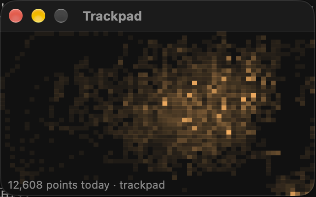
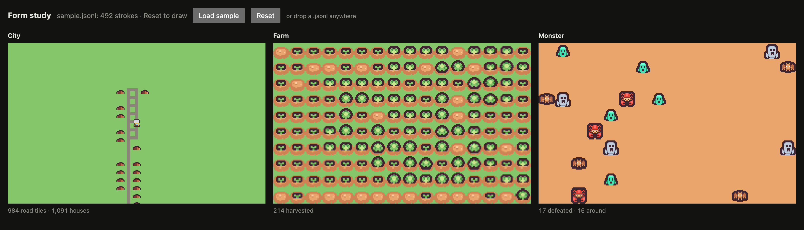
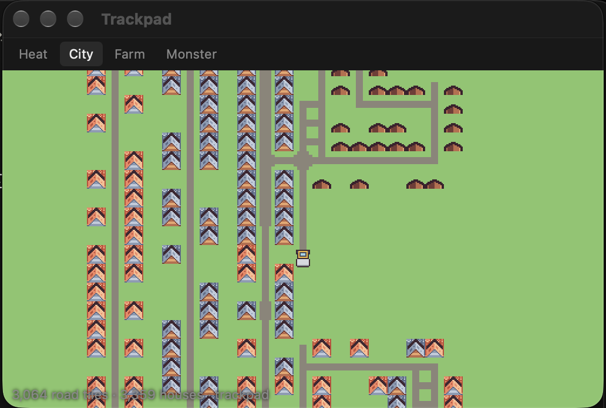

# Week 5 — Prototypes

I missed the class on October 6, so instead of finishing an in-class prototype I made two new ones, and then a third version after feedback from a classmate.

## Prototype 1: Capture

A small Mac window that stays on top and records every finger on the trackpad while I do other things, saving each day to a file and drawing it as a heat map. This was the open question from week 2. There is no public API for raw trackpad touches, but Apple's private MultitouchSupport framework works, and a ten-second test on macOS 27 picked up 951 frames. I needed the real fingers rather than the cursor, because two-finger scrolling, which is most of what my hand does, doesn't move the cursor. It's works-like.

## Prototype 2: Form study

The same file drawn three ways side by side: City grows roads where my fingers go, Farm waters the plots I touch, and Monster spawns monsters that my swipes defeat, so they collect where I never touch. On a real evening the farm filled up in twenty minutes and the city packed the middle into one block of road with no room for houses; the monsters were the most honest of the three. It's looks-like, with Kenney's free pixel tiles as placeholder art.

## Iteration

I moved the forms into the Capture window so they grow live while I work. A classmate suggested turning the city into a steamroller that never stops, where my swipes only change its direction, so now it drives across a map with no edges and houses grow along the road behind it. That changes what the city records, from where my finger was to which way my hand moved, and I'm not sure yet whether it still reads as wear.

## Timeline

| Date | Class | What I bring |
|---|---|---|
| Oct 13 | Desk critique | These prototypes |
| Oct 20 | Pin-up: proof of concept | The form I keep after the crit, running all day on my laptop |
| Oct 27 | World setting | The look beyond the placeholder tiles, and where the window lives on the desktop |
| Nov 3 | Desk critique | Growth rates tuned on a week of my own data |
| Nov 10 | Playtest | A build classmates can install and leave running for a day |
| Nov 17 | Interaction and engagement | Final art and the moment you check on it |
| Nov 24 | Desk critique | Fixes from the playtest |
| Dec 1 | The deck | Final deck and documentation |
| Dec 8 | Final | Presentation |

## Bill of materials

No physical parts: the MacBook trackpad, Tauri and Rust for the app, PixiJS for drawing, and Kenney's CC0 tiles. The code is in [prototypes/](../prototypes/).

## Questions

Which of the three would make you want to check on it again later in the day?

Looking at the city, can you guess anything about how I use my laptop without me explaining?
