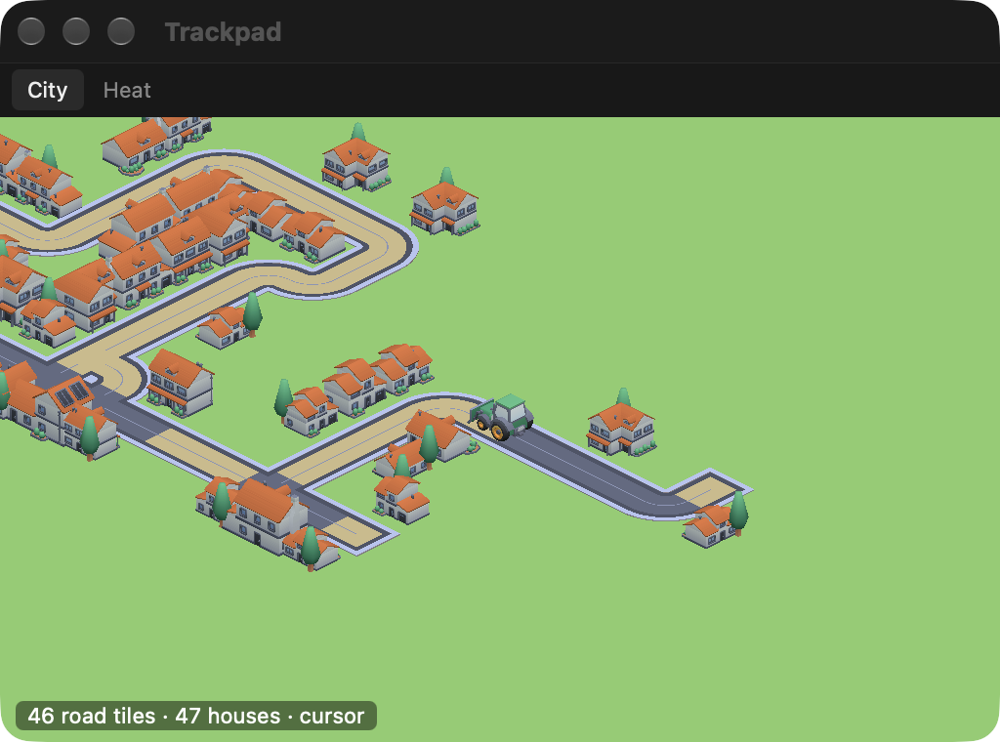
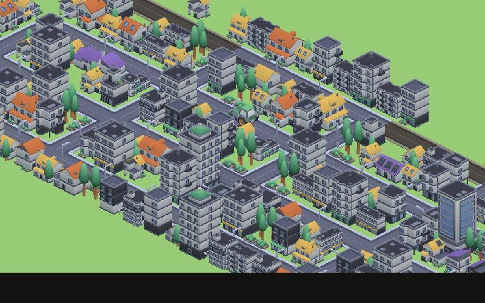

# Week 7 — The city, in 3D

At the pin-up everyone picked the city, so this week I only worked on that.

## What changed

The first problem was the trail. Over a whole day the city came out as one long line, because the roller kept driving straight for up to five minutes after I stopped touching the trackpad. Now it slows down and parks after 30 seconds. On my Oct 11 recording the longest straight road went from 635 tiles to 163.

It was still one long north–south band, because two-finger scrolling, which is most of what my hand does, kept steering it up and down. So I dropped the trackpad and steer with the pointer instead: the direction the cursor moves turns the roller, and it works with a mouse too. Typing and scrolling don't count anymore, so those hours look quiet. I'm not sure yet how I feel about that, since the project started from the fingers.

I also moved to a 45° isometric view with Kenney's free City Kit. I was worried 3D would eat the laptop, so I measured it in the real window: about 12% CPU while driving, less than the old 2D window (22%), which redrew on every touch.

## Borrowed mechanics

I looked at city builders and desk idle games (Cities: Skylines, Townscaper, Mini Motorways, Islanders, Rusty's Retirement, Keyboard Farm) and kept the parts that need no goals or streaks:

- roads get wider where I drive again
- a roof's colour is the hour the house grew, so a busy morning shows up as one colour
- houses take their shape from their neighbours: corner shops, rows, gardens
- total pointer distance unlocks parks, shops, apartments and a landmark
- the light follows the real time, and windows light up at night
- one city keeps growing across days

The screenshot above has the distance forced up so everything shows.

## Still open

- How fast should things unlock? I don't have a week of pointer data yet, so the numbers are guesses and probably too fast.
- Night is very dark in a 512 px window.
- Does a city made by the cursor still read as wear, or just as a game?
- At the playtest everyone starts from empty land. Is one day enough to see anything?

## Plan of attack

- Run it all day on my laptop this week and tune the unlocks on that data.
- Fix the night colours and the road colours.
- Package a build that saves to each person's own Mac.
- Playtest on Nov 17.

## Timeline

Oct 27 had no class, so everything after moved by a week.

| Date | Class | What I bring |
|---|---|---|
| Nov 3 | World setting | The 3D city, steered by the pointer |
| Nov 10 | Desk critique | Unlocks tuned on a week of my own pointer data |
| Nov 17 | Playtest | A build classmates can install; each starts from empty land |
| Nov 24 | Interaction and engagement | Night, colours and the moment you check on it |
| Dec 1 | Desk critique | Fixes from the playtest |
| Dec 8 | The deck | Final deck and documentation |
| Dec 15 (TBC) | Final | Presentation |

## Bill of materials

No physical parts: the MacBook and its pointer, Tauri and Rust for the app, Three.js for the 3D view, and Kenney's CC0 City Kit (Suburban, Commercial, Roads and Car Kit). The code is in [prototypes/](../prototypes/).
