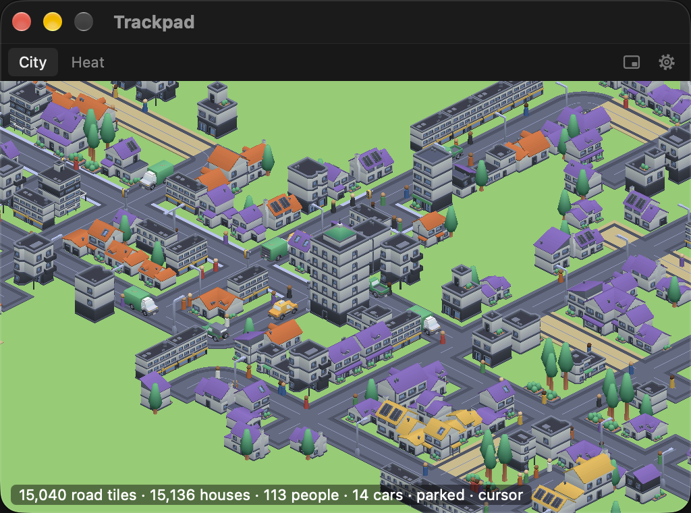
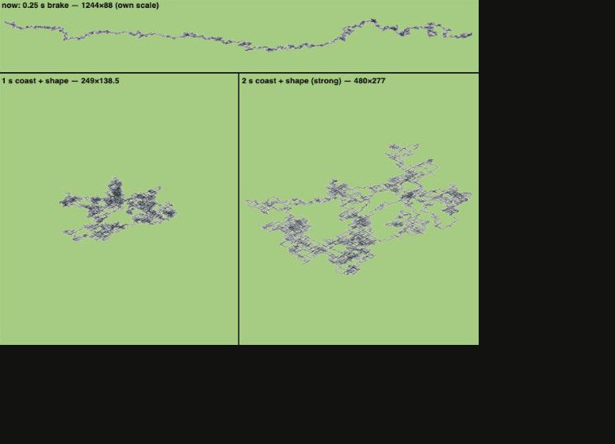
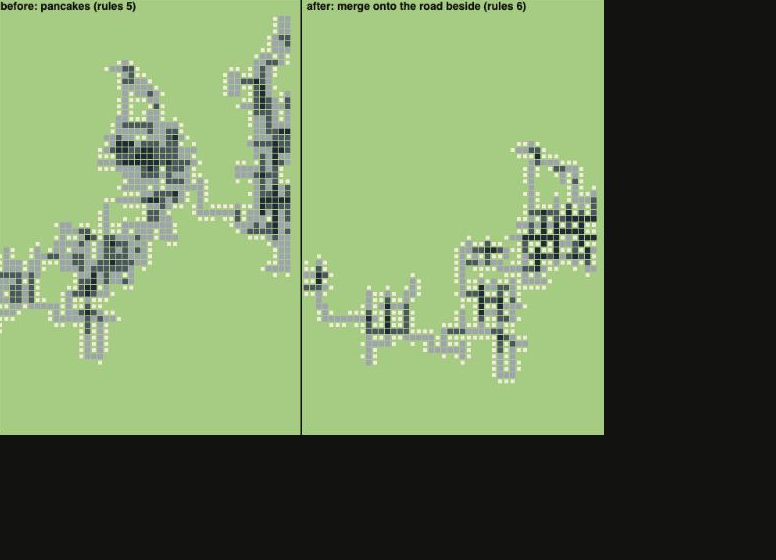
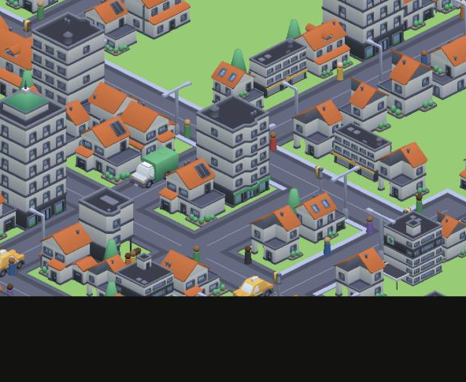
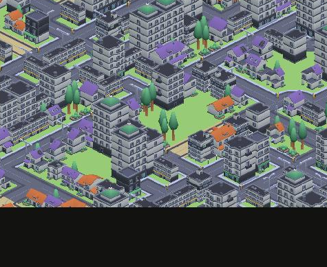
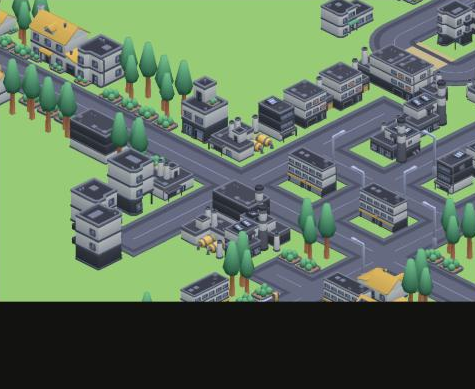
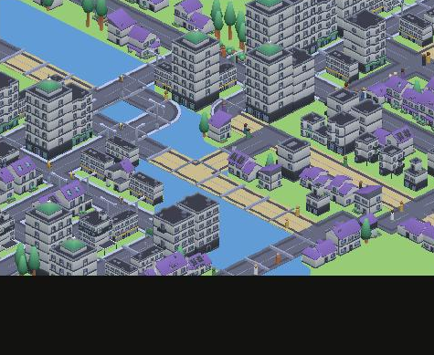

# Week 8 — Three decisions

This week was about the three decisions I kept pushing aside: how fast the roller goes, what the city looks like, and what kind of game this is. I made all three, then tuned everything on a week of my own cursor data (Nov 3 to Nov 10).

## 1. The roller's speed follows my hand

Until now the roller drove at a steady one tile a second. My cursor only chose its direction, so I couldn't tell the car was mine. Now its speed follows the cursor's: one tile for every 100 points the cursor moves, up to 20 tiles a second. When the cursor stops, the roller coasts for two seconds and stops.

That made the city worse at first. It came out as one long band, sometimes 16 times wider than tall, because my cursor moves left and right much more than up and down. So the coast became the tool: if the city is already wide, a coast that pushes it further sideways is cut short, and one that grows it up or down, or back toward the middle, runs longer. The roller still only goes where my cursor sends it.

On the same week of data, the band went from 18.9 : 1 to 1.9 : 1, and the city grew from 5,215 road tiles to 13,246.

## 2. From 2D to this 3D style

The first prototypes were flat 2D panels. In Week 7 I tried an isometric 3D city with Kenney's free City Kit, and this week I committed to it. It reads as a city from a glance, and it costs less than I feared: about 17% CPU with the 3D window open and traffic running.

Repeated driving used to pave whole blocks of road, like a pancake. Now the roller merges onto a road beside it instead of laying a second one next to it, so passes widen one street instead.

Solid 2×2 road blocks went from 2,764 to 0, and houses went up from 4,178 to 5,040, because every street now has two sides to build on.

## 3. City-building, not the other modes

In Week 5 I had four forms for the same data: a heat map, a city, a farm and a monster. My classmates picked the city at the pin-up, and this week I stopped keeping the others alive. Then I asked what makes a city feel like a city. I studied how Cities: Skylines 1 and 2, SimCity 4 and 2013, Mini Motorways and the paper behind CityEngine handle zones and roads, and kept only the rules that work with no player painting, just the cursor:

- **Road grades from passes.** Dirt, then asphalt, then streetlights, then avenues with sidewalks, crosswalks and traffic lights, then highways with barriers and signs.
- **Density follows the road.** A dirt road only gets small houses; an avenue lets apartments and towers grow, over time (SimCity 2013 does the same).
- **Zones.** Shops grow when there are fewer than one shop job per eight residents (the point where Cities: Skylines stops asking for more). Industry grows at the edge, at least three cells from any home. Neighbours along a street tend to match. Some homes on an avenue turn into shops, and on a highway they all become shops or offices.
- **Rivers.** Each Mac gets its own world, the roller bridges the water, and nothing is built on it.

On my week: 21% dirt roads, 35% streets, 23% lit streets, 16% avenues, 4.5% highways. Lots are 52% homes, 17% shops, 24% offices, 6% parks and 2% industry.

## Plan of attack, followed?

- Run it on my laptop all week and tune on that data: **done**, but I tuned speed, grades and zones instead of the unlocks.
- Fix the night colours: not yet.
- Package a build for each person's Mac: not yet.
- Playtest on Nov 17: still the plan.

## Still open

- Industry is rare (2%) and offices are too many (24%).
- The shop count only looks at what each lot was when it was made, so once homes on avenues turn into shops there are more shops than the 1-in-8 target (about one shop job per six residents on my week). Fixing next.
- Side streets off an avenue keep one cell of avenue at the corner.
- The water doesn't move yet.
- Does a city this complete still read as the trace of my hand?

## Plan for next week

- Fix the shop count and the side-street corners.
- Measure the frame rate while driving zoomed out.
- Night colours, and a build classmates can install for the playtest.

## Bill of materials

No physical parts: the MacBook and its cursor, Tauri and Rust for the app, Three.js for the 3D view, and Kenney's CC0 City Kit (Suburban, Commercial, Industrial, Roads and Car Kit). The code is in [prototypes/](../prototypes/), and the process pictures are in [docs/process/2026-11-10/](../docs/process/2026-11-10/).
